# A+ Connect

[](LICENSE)
[](https://github.com/asifahamed-ece/Aplus_Connect/releases)
[](#requirements)
[](#requirements)

I wanted O+ Connect's features on my Linux PC — mirror your phone's screen,
move files both ways, share the clipboard, and see notifications without
picking the phone up. A+ Connect is an independent open-source reimplementation
of OPPO's O+ Connect client, built for the OPPO Reno 14 5G (ColorOS 15/16/17,
Android 15/16).

It talks to the phone two ways, and you can use either or both.

## The two connection paths

| | **ADB path** | **Companion path** |
|---|---|---|
| Needs a cable | Once, to enable wireless debugging | Never |
| Needs developer options | Yes | No |
| Screen mirroring | Full, with touch control (scrcpy) | View-only |
| File transfer | Two-way, any folder | Browse/search the phone, download, and send files to it |
| Clipboard | Two-way | Two-way, with no tap on the phone |
| Notifications | App name only (text is a placeholder) | Real text, dismissible from the desktop |
| Media control | — | Phone appears as an MPRIS player |

The companion path is a small app on the phone that dials out to this desktop
over TLS. The phone never opens a listening port.

## Features

- **Companion file browser** — browse and search the phone's whole storage
  read-only, download single or multiple files, and push files to it.
- **Clipboard sync** — bidirectional, background, no tap required on the
  companion path.
- **Media control** — the phone's current player is published as an MPRIS
  player, so the shell's media widget can pause, skip, and seek it.
- **Pairing** — by QR code or address + one-time code, with certificate pinning.
- **Kill switch** — turn the companion off on either side; the choice is
  remembered and the other side is told why.
- **Tray app** — closing the window hides to the tray instead of quitting.

## Interface Showcase

A+ Connect features a cohesive frosted glass design language inspired by ColorOS and O+ Connect, complete with fluid transparency and live hardware telemetries across both the Linux desktop and Android mobile companion.

### Mobile Companion App (ColorOS / Android)

The Android companion client runs on the OPPO Reno 14 5G. Below is an interface tour across all primary screens, showcasing alternating Light and Dark modes alongside active file transfer progress:

| Connect (Light Mode) | Files & Active Transfer (Dark Mode) | Clipboard Sync (Light Mode) |
| :---: | :---: | :---: |
| 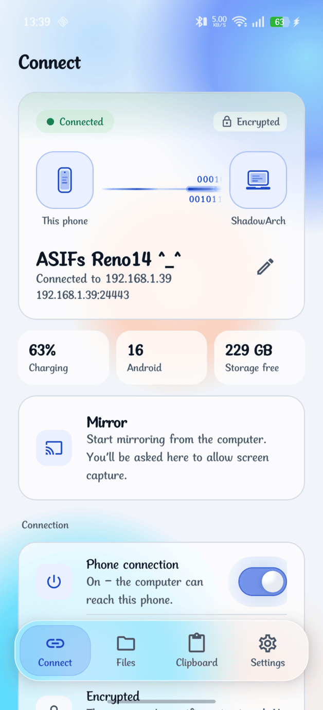 | 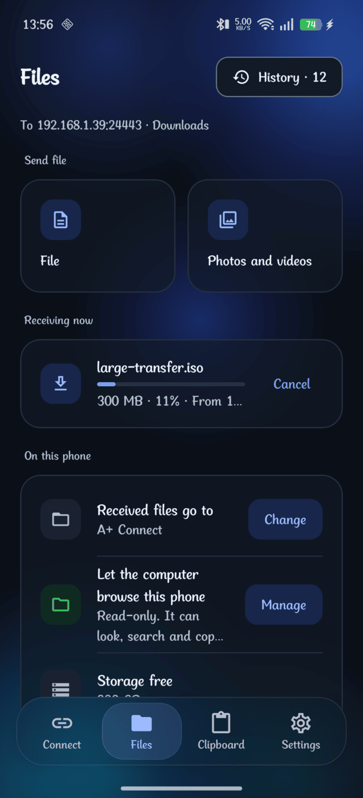 | 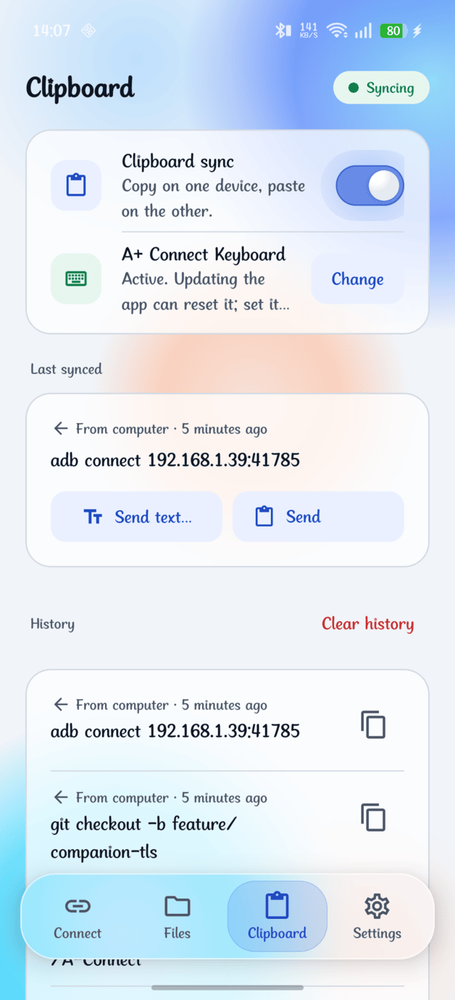 |
| **Encrypted Link & Vitals**<br>Connection state, IP/port, battery level, Android version, and storage telemetry. | **Active File Transfer**<br>Real-time reception progress bar (`large-transfer.iso`, 300 MB) with transfer rate and cancellation. | **Bidirectional Clipboard**<br>Live clipboard sync status, background keyboard engine, and clip history. |

<br>

| Transfer History (Dark Mode) | Settings & Customization (Light Mode) |
| :---: | :---: |
| 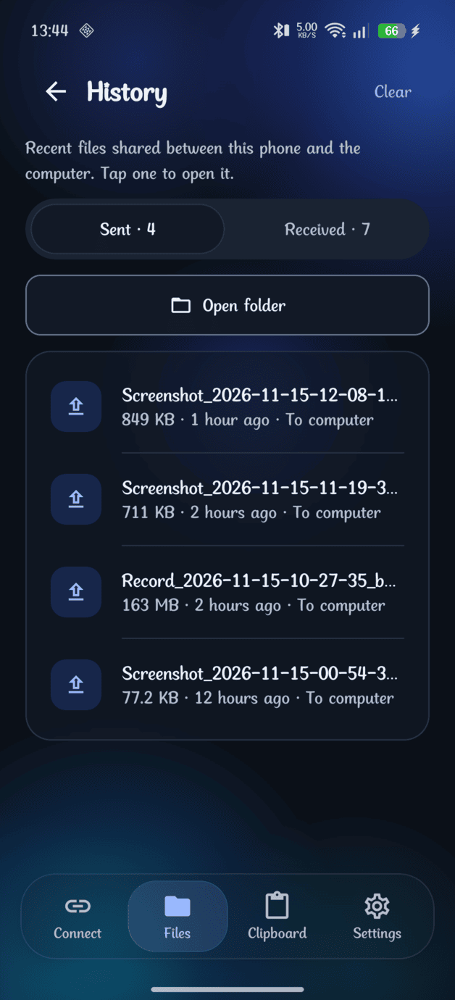 | 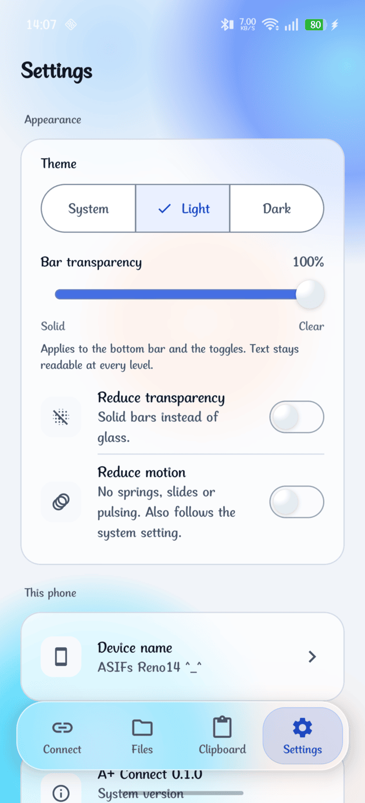 |
| **Transfer History**<br>Audited log of sent & received files with timestamps, file sizes, and quick open actions. | **Appearance & Themes**<br>Theme selector (Light/Dark/System), frosted glass opacity slider, and motion toggles. |

### Desktop Application (Linux / Electron)

The Linux desktop client runs natively on KDE / Wayland and X11 sessions, featuring frosted glass cards, system tray integration, and real-time device telemetries:

#### 1. Device Connection & Vitals
Overview of paired devices, battery levels, storage statistics, TLS encryption status, and one-click screen mirroring.
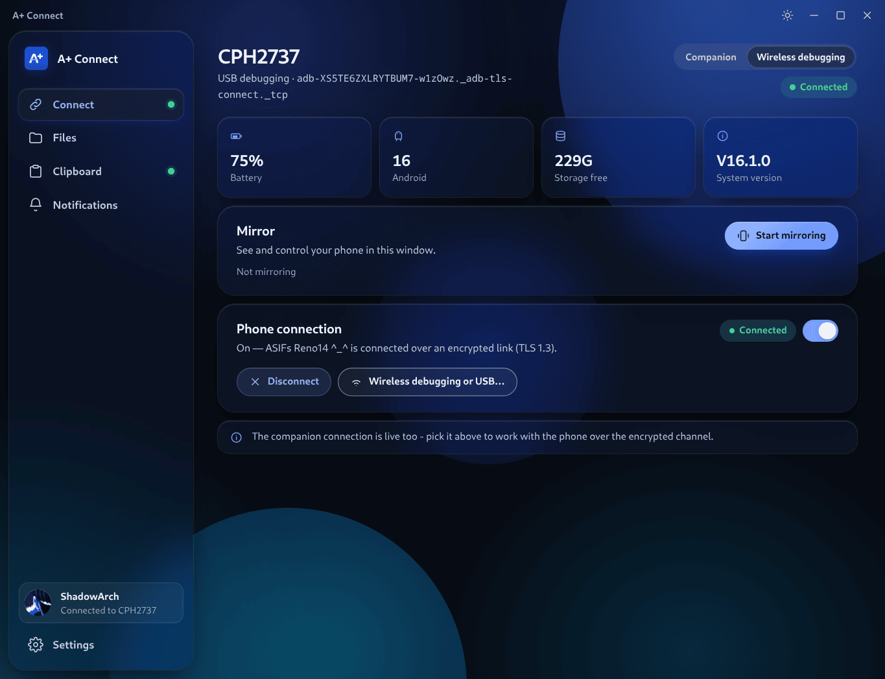

#### 2. File Sharing & Active Progress
Integrated phone storage browser, search, multi-file batch downloads, and real-time upload progress with speed metrics and cancellation.
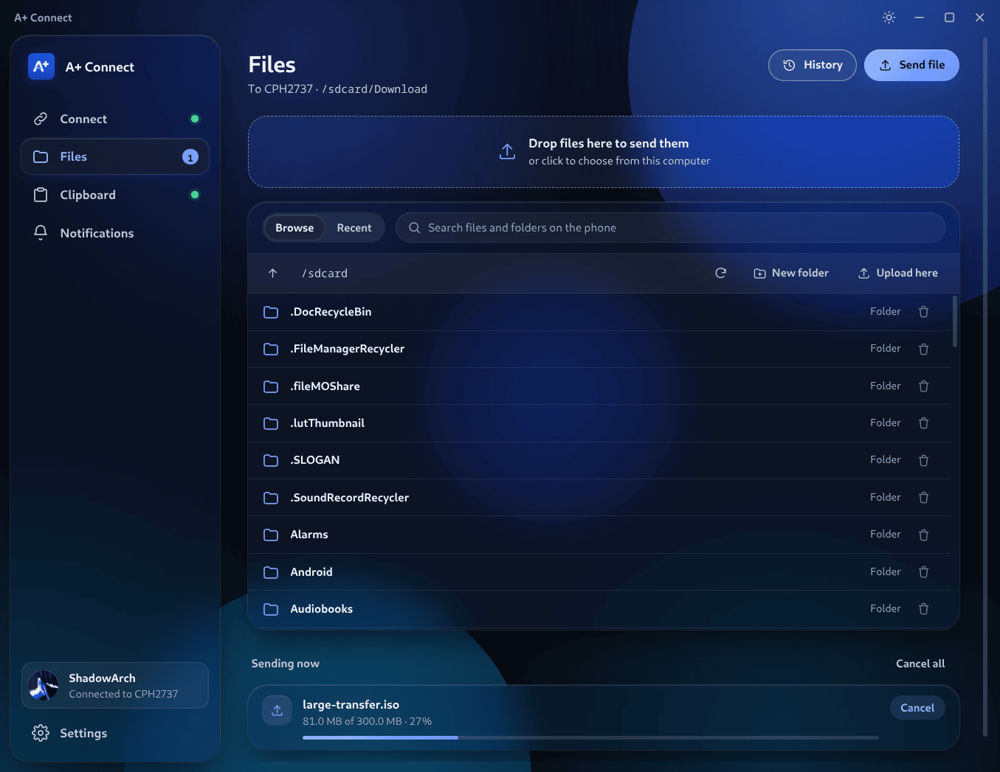

#### 3. Bidirectional Clipboard Sync
Instant clipboard synchronization between desktop and phone, clipboard history with one-click copying, and direction indicators.
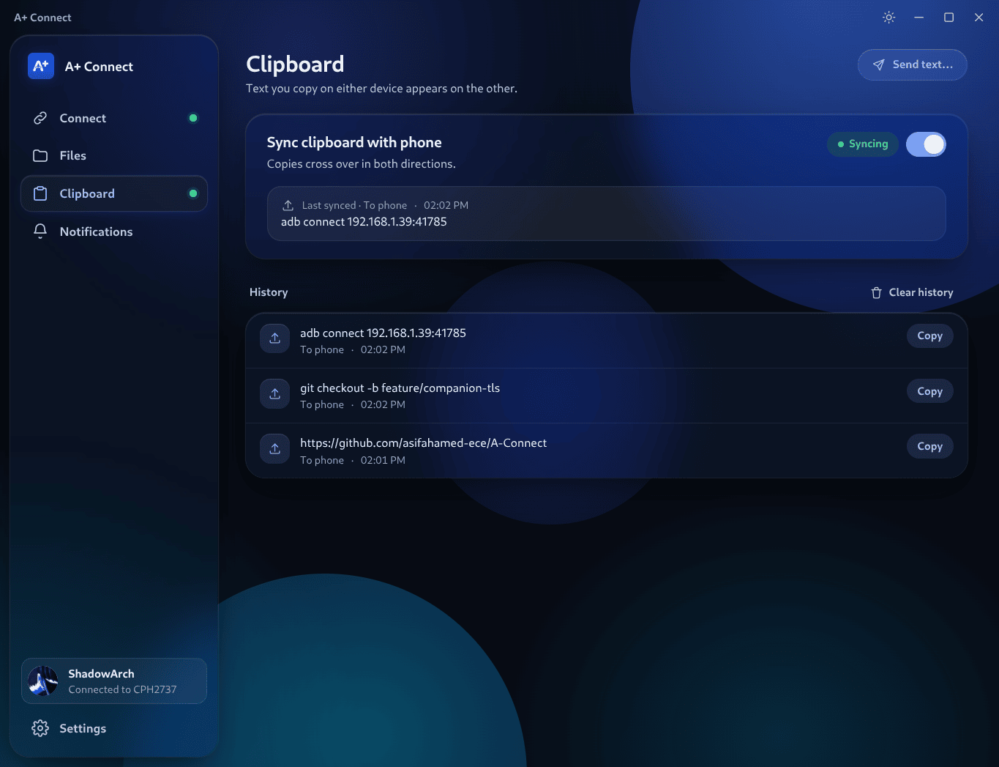

#### 4. Mirrored Phone Notifications
Phone notification drawer displaying ongoing media controls and dismissible alerts in real time.
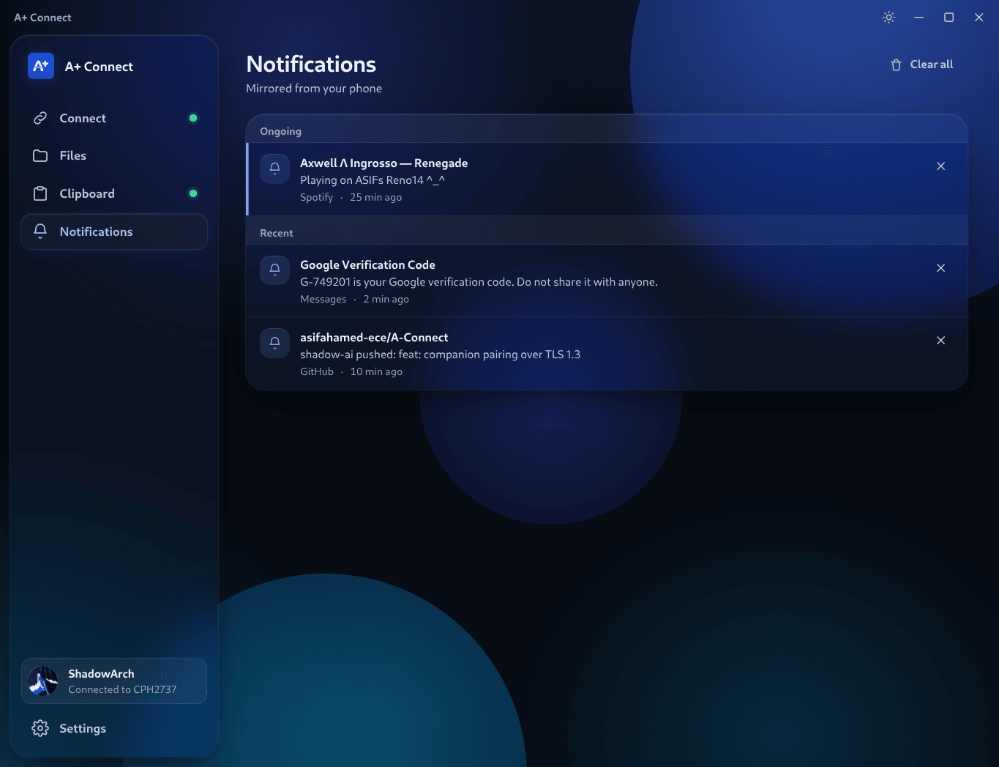

#### 5. Transfer History
Comprehensive transfer logs categorized by incoming and outgoing files, with direct folder opening and item management.
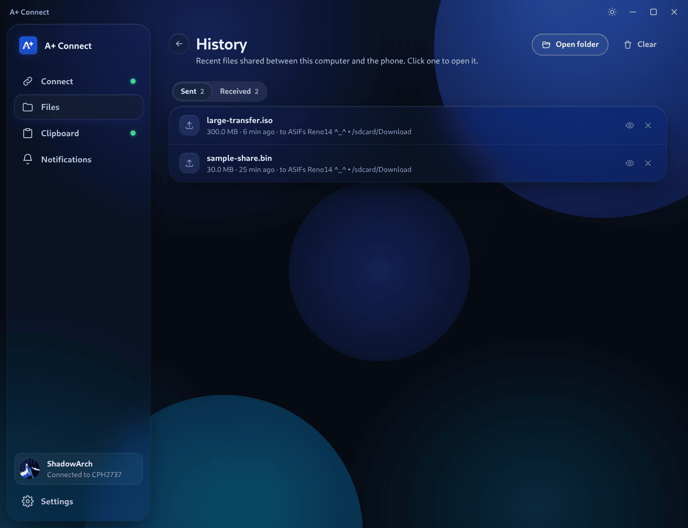

#### 6. Settings & Customization
Configurable appearance themes, glass transparency adjustment, motion preferences, and local download destination path.
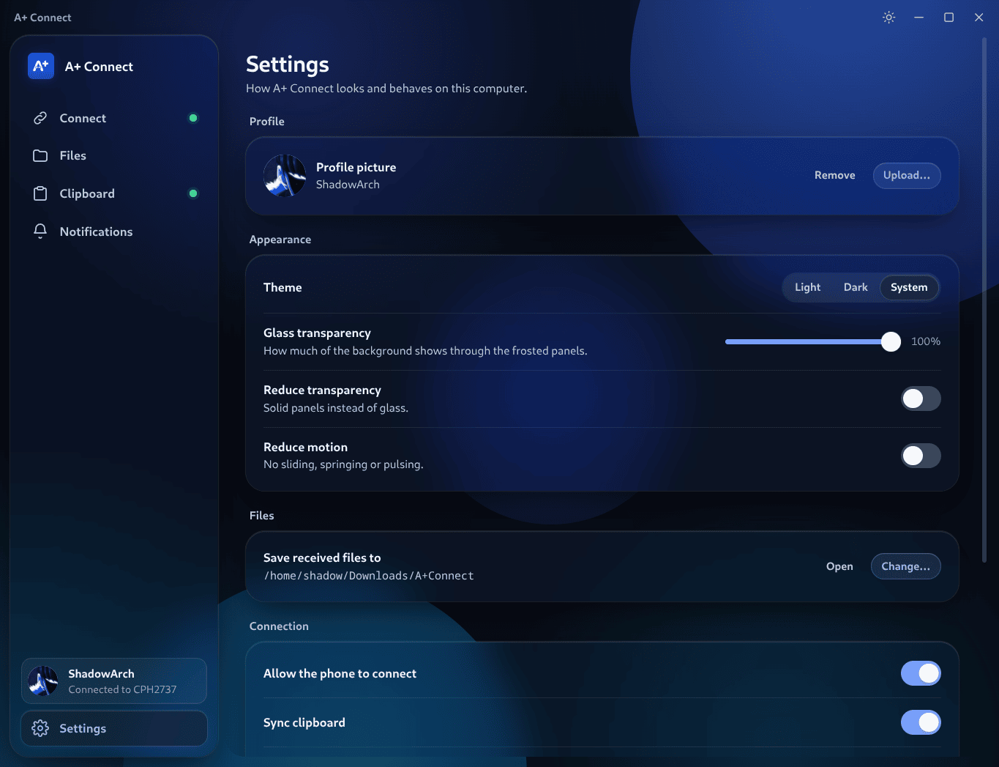

## Requirements

**System binaries on `PATH`:**

- `electron` (44+)
- `adb` (android-tools) — for the ADB path
- `scrcpy` 5.x — its server is pushed to the phone for the ADB path
- `wl-paste` + `wl-copy` (Wayland) or `xclip` (X11)
- `notify-send` (libnotify) — fallback when no notification daemon is present

**npm dependencies** (declared in `package.json`, installed with `npm install`):

- `@yume-chan/adb`, `@yume-chan/adb-scrcpy`, `@yume-chan/adb-server-node-tcp`,
  `@yume-chan/scrcpy` — speak the scrcpy protocol over ADB from Node; this is how
  the desktop reads the phone clipboard on the ADB path.
- `dbus-next` — talks to the desktop notification daemon directly.
- `qrcode` — pairing QR codes.

`npm start` runs `scripts/ensure-deps.js` first and exits with a clear message
if the modules are missing.

## Install and run

```bash
cd "A+ Connect"
npm install
npm start
```

`npm start` and `npm run dev` are the same command:
`electron . --disable-vulkan`. The window needs a real X11/Wayland session; it
will not run headless.

### Companion path: no cable, no developer options

Download the pre-built APKs directly onto your phone from the [Latest Release](https://github.com/asifahamed-ece/Aplus_Connect/releases/latest):

| Package | Direct Download Link | Purpose |
|---|---|---|
| **A+ Connect Companion** | [⬇️ Download `A-Plus-Connect-android.apk`](https://github.com/asifahamed-ece/Aplus_Connect/releases/latest/download/A-Plus-Connect-1.1.2-android.apk) | Core companion service for file transfers, notification mirroring, screen mirroring, and media controls. |
| **A+ Connect Keyboard** | [⬇️ Download `A-Plus-Connect-Keyboard-android.apk`](https://github.com/asifahamed-ece/Aplus_Connect/releases/latest/download/A-Plus-Connect-Keyboard-android.apk) | Patched HeliBoard IME for seamless, background phone ↔ PC clipboard synchronization without tripping banking restrictions. |
| **A+ Connect Desktop** | [⬇️ Download `A-Plus-Connect-x86_64.AppImage`](https://github.com/asifahamed-ece/Aplus_Connect/releases/latest/download/A-Plus-Connect-1.1.2-x86_64.AppImage) | Standalone desktop AppImage — run on any Linux desktop without building from source. |

#### Setup steps:

1. **Install the Companion APK:**
   * Download and install `A-Plus-Connect-android.apk` on your phone.
   * Open the app and grant **Notification access** (*Settings → Special app access → Notification access*) when prompted so notifications can be mirrored.
   * Grant **All files access** to allow browsing and transferring files.

2. **Install the Keyboard APK (required for bidirectional clipboard):**
   * Download and install `A-Plus-Connect-Keyboard-android.apk`.
   * Enable it in **Settings → System & updates → Keyboard & input method**.
   * Set **A+ Connect Keyboard** as the default keyboard. Android 10+ exclusively permits the active default keyboard to read the clipboard in the background without user interaction.

3. **Start the Desktop app:**
   * Run via source:
     ```bash
     npm start
     ```
   * Or run the standalone AppImage:
     [⬇️ Download `A-Plus-Connect-x86_64.AppImage`](https://github.com/asifahamed-ece/Aplus_Connect/releases/latest/download/A-Plus-Connect-1.1.2-x86_64.AppImage)

4. **Pair the devices:**
   * In the mobile app, tap **Connect**.
   * Scan the pairing QR code shown on the desktop app, or enter the local IP address and 6-digit one-time code. Both devices connect immediately over an encrypted TLS 1.3 link.

To check local companion preconditions first:

```bash
node scripts/check-without-adb.js
```

The full walkthrough is in
[`scripts/verify-without-adb.md`](scripts/verify-without-adb.md), and the
per-feature status is in
[`docs/companion/companion-status.md`](docs/companion/companion-status.md).

## Using it

**Files.** Either finder accepts files dragged onto the window. Tick the
checkboxes on individual files to build a batch, then use **Download selected**;
**Clear selection** empties the batch, including files you selected in another
folder. Transfer progress appears in the same list for both connections.

**Notifications.** Phone alerts land in the Notifications view and as desktop
bubbles. Notifications that update replace their existing bubble. Clearing the
app's history is local — it does not clear anything on the phone.

**Clipboard.** Copy on either device and paste on the other. Text only.

**Mirroring.** Use the ADB connection for a mirror you can interact with; the
companion path gives a view-only stream.

## Architecture

```
┌──────────────────────────────────────────────────────────┐
│                   A+ Connect (Electron)                  │
│   main process · tray · IPC · renderer (HTML/CSS/JS)     │
└───────────┬───────────────────────────────┬──────────────┘
            │                               │
   ┌────────▼─────────┐            ┌────────▼──────────┐
   │    ADB path      │            │  Companion path   │
   │ adb · scrcpy 5.x │            │ TLS · protocol.js │
   │ UHID input       │            │ clipboard bridge  │
   │ file push/pull   │            │ files · media     │
   └────────┬─────────┘            └────────┬──────────┘
            │                               │
            └───────────────┬───────────────┘
                            │
                 ┌──────────▼───────────┐
                 │  ColorOS phone       │
                 │  (Reno 14 5G)        │
                 └──────────────────────┘
```

The renderer never touches Node. It talks to the main process only through
`window.api`, exposed by `preload.js` with `contextIsolation` on.

## Project structure

```
A+ Connect/
├── main.js                     Electron main process, tray, IPC handlers
├── preload.js                  contextBridge → window.api
├── package.json
├── services/
│   ├── adb.js                  Device discovery, pairing, shell
│   ├── scrcpy.js               Mirroring over ADB
│   ├── file-transfer.js        Push / pull, collision-safe naming
│   ├── clipboard.js            Desktop clipboard (wl-clipboard / xclip)
│   ├── clipboard-bridge.mjs    ESM bridge to the scrcpy-protocol libraries
│   ├── notifications.js        Notification history and mirroring
│   ├── desktop-notify.js       D-Bus notification drawer (dbus-next)
│   ├── companion.js            TLS companion server
│   ├── companion-protocol.js   Wire framing
│   ├── companion-cert.js       Certificates and pinning
│   ├── companion-handshake.js  Pairing handshake
│   ├── mirror.js               Companion view-only mirror
│   ├── mpris.js                Media player over D-Bus
│   ├── h264.js                 Video decode helpers
│   └── preview-cache.js        Cached previews, keyed by hash
├── src/
│   ├── index.html              UI structure
│   ├── style.css               Design tokens + styling
│   └── renderer.js             UI logic
├── companion-android/          Kotlin / Jetpack Compose phone app
├── scripts/                    Verification and setup scripts
├── docs/
│   ├── companion/              How the companion path works today
│   └── superpowers/            Designs and plans for shipped work
├── assets/                     Original A+ Connect brand assets
└── setup-usb.sh                One-time wireless ADB setup
```

## Troubleshooting

**Closing the window doesn't quit.** That's intentional — it hides to the tray.
Quit from the tray menu.

**Device not found over ADB.** Check that wireless debugging is on, both
devices are on the same network, and the phone's IP hasn't changed. Re-run
`./setup-usb.sh` if needed.

**Mirroring fails to start.** Confirm `scrcpy --version` is 5.x and accept the
screen-capture prompt. The encoder is pinned to the MediaTek HEVC encoder and
H.265; a phone with a different SoC needs a different encoder in
`services/scrcpy.js`.

**Files transfer but the phone shows no alert.** Expected on the ADB path —
file notifications are not implemented there.

**Notification text says "New notification".** Expected on the ADB path, which
reads `adb logcat` and only gets the app name. The companion path carries real
text.

**Clipboard won't sync.** Text only, and on the companion path the A+ Connect
keyboard must be the phone's default keyboard — Android grants background
clipboard access to the default keyboard and nothing else.

**The app won't start and mentions a missing module.** Run `npm install`.

## What this does not do

- The companion file browser is **read-only**; it cannot delete or rename on the
  phone.
- The companion mirror is **view-only**; interaction requires the ADB path.
- ADB-path notifications carry only the app name.
- The MediaTek encoder setting targets the Dimensity-based Reno 14; other phones
  need a code change.

## Documentation map

| Document | What it is |
|---|---|
| [`CONTRIBUTING.md`](CONTRIBUTING.md) | Setup, architecture, checks, and pull-request expectations |
| [`CHANGELOG.md`](CHANGELOG.md) | Release history |
| [`SECURITY.md`](SECURITY.md) | How to report a vulnerability privately |
| [`CODE_OF_CONDUCT.md`](CODE_OF_CONDUCT.md) | Community standards |
| [`AGENTS.md`](AGENTS.md) | Conventions and gotchas for agents working in this repo |
| [`docs/companion/companion-status.md`](docs/companion/companion-status.md) | How each companion feature works, and its limits |
| [`docs/companion/`](docs/companion/) | Keyboard fork, clipboard handoff, file access, spike results |
| [`docs/superpowers/specs/`](docs/superpowers/specs/) | Designs for the features that shipped |
| [`docs/superpowers/plans/`](docs/superpowers/plans/) | Implementation plans for the companion work |
| [`docs/archive/`](docs/archive/) | Historical early design documents and reverse-engineering notes |

> **Historical documents.** Files archived under [`docs/archive/`](docs/archive/)
> (`development-plan.md`, `implementation-roadmap.md`, `project-documentation.md`,
> `protocol-specifications.md`, and `WEEKEND-SPRINT-SUMMARY.md`) describe an early
> aspirational design (a Rust transport, a Qt6/Kirigami UI, a D-Bus service). None
> of that was built. The shipped app is Electron. They are kept for reference only.

## Contributing

Contributions are welcome — bug reports, device reports, documentation fixes,
and code. Start with [`CONTRIBUTING.md`](CONTRIBUTING.md) (setup, the four-layer
wiring pattern, and what verification is actually available), and note that the
desktop app has no test runner or CI: changes are verified by running the app.

Please follow the [Code of Conduct](CODE_OF_CONDUCT.md). Security problems go
through [`SECURITY.md`](SECURITY.md), never a public issue. Release history is
in [`CHANGELOG.md`](CHANGELOG.md).

## License

**MIT** — the full text is in [`LICENSE`](LICENSE), and the machine-readable
declaration is `"license": "MIT"` in `package.json`.

Scope, stated plainly in [`NOTICE`](NOTICE):

| Part of the repo | License |
|---|---|
| Electron app (`main.js`, `preload.js`, `src/`, `services/`, `scripts/`) | MIT |
| Android companion app (`companion-android/`) | MIT |
| Keyboard patch (`keyboard/patch-heliboard.py`) | MIT |
| `assets/` — original A+ Connect brand assets | MIT |
| The A+ Connect keyboard APK (HeliBoard fork, not vendored) | GPL-3.0 |

Third-party components and their licenses are listed in
[`CREDITS.md`](CREDITS.md). If you reuse this project, keep the copyright notice
and do not present OPPO's assets as original work.

## Trademark Disclaimer

A+ Connect is an independent open-source project and is not affiliated with,
endorsed by, or sponsored by Guangdong OPPO Mobile Telecommunications Corp.,
Ltd. "OPPO", "ColorOS", and "O+ Connect" are trademarks or registered
trademarks of Guangdong OPPO Mobile Telecommunications Corp., Ltd. All other
trademarks, service marks, and trade names are the property of their respective
owners. References to these names and marks are made solely for device
compatibility and identification purposes.

## ADB Path Features

A+ Connect also supports a wired ADB connection path for use cases where the
companion app is not installed:

- **Screen mirroring** — scrcpy 5.x with UHID input injection, which bypasses
  ColorOS's shell touch filters, so taps and drags work.
- **File transfer** — drag files onto the window to send them, or browse the
  phone and pull files back. Multiple files can be selected and downloaded in
  one batch; same-named files no longer overwrite each other.
- **Notification mirroring** — phone notifications appear in a desktop drawer
  and in the app's history. On the ADB path, text is a placeholder ("New
  notification"); only the app name is real. The companion path carries real text.

### ADB path: one-time USB setup

```bash
# 1. Plug the phone in over USB
# 2. Accept "USB debugging" on the phone
./setup-usb.sh
```

The script enables wireless ADB, reads the phone's address, and connects. After
that, `npm start` reconnects over Wi-Fi while both devices are on the same
network.

## Acknowledgements

- **Scrcpy** — Genymobile's screen mirroring engine.
- **O+ Connect** — OPPO's official client; UI design inspiration.
- **HeliBoard** — the keyboard the companion clipboard path forks.